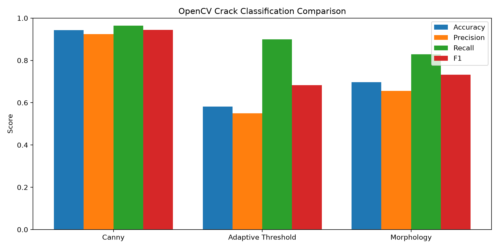

# Automated Concrete Crack Detection Using Computer Vision Techniques for Structural Health Monitoring

## Project Overview

This research project investigates automated concrete surface crack detection using traditional computer vision and image-processing techniques.

The project implements and evaluates three OpenCV-based approaches:

1. Canny Edge Detection
2. Adaptive Thresholding
3. Morphological Processing

The primary objective is to compare the effectiveness of these methods in identifying visible concrete surface cracks using a labeled image dataset.

The project includes a literature review, research methodology, experimental evaluation, quantitative performance analysis, and an interactive web application for demonstrating concrete crack detection.

## Research Background

Concrete cracks are common indicators of deterioration in civil infrastructure, including bridges, buildings, roads, and pavements.

Traditional visual inspection can be time-consuming, labor-intensive, and subjective. Automated image-processing techniques can assist inspectors by identifying potential surface defects in digital images.

Existing research has investigated traditional edge detection, adaptive thresholding, morphological operations, machine learning, and deep-learning approaches for concrete crack detection.

This research focuses on evaluating lightweight traditional computer vision techniques as reproducible baselines for automated concrete crack classification.

## Literature Review

The research documentation includes a collection of ten published research papers related to concrete crack detection.

The literature covers:

- Traditional edge detection and image processing
- Adaptive thresholding techniques
- Morphological image processing
- Concrete crack image datasets
- CNN-based crack detection
- Pixel-level crack segmentation
- Structural health monitoring

Key studies include Cha et al. (2017), Jahanshahi and Masri (2012), Dorafshan et al. (2018), Qu et al. (2018), Kim and Cho (2018), Li and Zhao (2020), Kim and Son (2023), Khan et al. (2023), and Avendaño et al. (2024).

These studies provide background on existing crack detection methodologies, their strengths, and their limitations.

See [Literature Review](docs/literature_review.md) and [Bibliography](docs/references.bib) for further information.

## Research Objectives

1. Develop an automated concrete surface crack detection system using Python and OpenCV.
2. Apply grayscale conversion and Gaussian filtering for image preprocessing.
3. Implement and compare Canny edge detection, adaptive thresholding, and morphological processing.
4. Develop image-level classification rules using foreground-pixel density.
5. Evaluate classification performance using accuracy, precision, recall, F1-score, and confusion matrices.
6. Analyze the experimental findings and limitations of the selected techniques.
7. Develop an interactive application for demonstrating the crack detection process.

## Dataset

**Dataset:** Concrete Crack Images for Classification

**Source:** https://data.mendeley.com/datasets/5y9wdsg2zt/2

The dataset contains 40,000 labeled concrete surface images.

| Class | Number of Images |
|---|---:|
| Positive (Crack) | 20,000 |
| Negative (No Crack) | 20,000 |
| **Total** | **40,000** |

A balanced subset of 400 images was selected for preliminary experimental evaluation.

### Experimental Dataset Split

| Subset | Positive | Negative | Total |
|---|---:|---:|---:|
| Calibration | 60 | 60 | 120 |
| Testing | 140 | 140 | 280 |
| **Total** | **200** | **200** | **400** |

The complete dataset is stored locally and excluded from GitHub to avoid uploading large image files.

## Research Methodology

The experimental workflow consists of five stages.

### Stage 1 — Image Acquisition

Concrete surface images are loaded from the labeled dataset containing cracked and non-cracked samples.

### Stage 2 — Image Preprocessing

Each image is:

- Converted to grayscale.
- Resized to 227 × 227 pixels.
- Processed using a 5 × 5 Gaussian filter to reduce image noise.

### Stage 3 — Crack Feature Extraction

Three image-processing approaches are implemented.

**1. Canny Edge Detection**

Canny edge detection is applied to Gaussian-filtered images using lower and upper thresholds of 50 and 150.

**2. Adaptive Thresholding**

Gaussian adaptive thresholding with binary inversion is applied to identify potential crack regions based on local intensity differences.

**3. Morphological Processing**

Morphological opening is applied to the adaptive thresholding output using a 3 × 3 kernel to remove small foreground regions.

### Stage 4 — Image Classification

The proportion of nonzero pixels in each processed image is calculated as an image-level feature.

For each technique, a classification threshold and comparison direction are selected using the calibration subset to maximize F1-score.

The selected rules are then applied to the separate test images.

### Stage 5 — Performance Evaluation

Classification performance is evaluated using:

- Accuracy
- Precision
- Recall
- F1-score
- Confusion matrices

## Experimental Results

The following results were obtained from 280 held-out test images.

| Technique | Accuracy | Precision | Recall | F1-score |
|---|---:|---:|---:|---:|
| **Canny Edge Detection** | **94.29%** | **92.47%** | **96.43%** | **94.41%** |
| Adaptive Thresholding | 58.21% | 55.02% | 90.00% | 68.29% |
| Morphological Processing | 69.64% | 65.54% | 82.86% | 73.19% |

Canny edge detection achieved the highest classification accuracy and F1-score among the three evaluated approaches.

These results apply to the selected experimental sample and configuration. They do not establish that Canny is universally superior to other crack detection techniques.

### Performance Comparison



Additional experimental results, including confusion matrices and prediction records, are available in the `experiments/results/` directory.

## Interactive Web Application

The project includes an interactive web application developed using Streamlit.

The application provides a simple interface for demonstrating concrete crack detection without requiring users to interact directly with Python scripts.

### Application Features

- Upload concrete surface images in JPG, JPEG, or PNG format.
- Display image-level Crack Detected or No Crack Detected predictions.
- Visualize Canny edge detection results.
- Visualize adaptive thresholding results.
- Visualize morphological processing results.
- Display experimental accuracy comparisons.

The application uses the calibrated Canny edge-density classification rule developed during the experimental evaluation.

It does not use a trained CNN model.

### Running the Application

From the project root directory, execute:

```bash
python -m streamlit run app/app.py
```

The application should open automatically in your browser.

Alternatively, visit:

http://localhost:8501

Upload a concrete image to view the classification result and processed images.

**Note:** The application is intended as a research demonstration. Predictions on images outside the evaluation dataset may be less reliable.

## Project Structure

```text
automated-concrete-crack-detection/
│
├── src/
│   ├── main.py
│   └── crack_detection.py
│
├── app/
│   └── app.py
│
├── data/
│   ├── README.md
│   └── raw/
│       ├── Positive/
│       └── Negative/
│
├── experiments/
│   ├── evaluate.py
│   └── results/
│       ├── metrics.csv
│       ├── predictions.csv
│       ├── metrics_comparison.png
│       └── confusion_*.png
│
├── docs/
│   ├── research_papers/
│   ├── literature_review.md
│   ├── references.bib
│   ├── research_gap.md
│   ├── research_proposal.md
│   ├── methodology.md
│   ├── experiment_log.md
│   └── results_analysis.md
│
├── reports/
│
├── README.md
├── requirements.txt
└── .gitignore
```

## Technologies Used

- **Programming Language:** Python
- **Computer Vision:** OpenCV
- **Numerical Computing:** NumPy
- **Data Visualization:** Matplotlib
- **Evaluation Metrics:** Scikit-learn
- **Web Application:** Streamlit
- **Version Control:** Git and GitHub
- **Research Documentation:** Markdown, BibTeX, and LaTeX / Overleaf

## Installation

### 1. Clone the Repository

```bash
git clone https://github.com/sarthak0417/automated-concrete-crack-detection.git
cd automated-concrete-crack-detection
```

### 2. Create a Virtual Environment

```bash
python -m venv .venv
```

### 3. Activate the Environment

On Windows PowerShell:

```powershell
.venv\Scripts\Activate.ps1
```

### 4. Install Dependencies

```bash
python -m pip install -r requirements.txt
```

## Running the Project

### Single-Image Processing

Run:

```bash
python src/main.py --image path/to/concrete_image.jpg
```

The program applies the OpenCV processing techniques and saves the generated images and comparison figure inside `experiments/results/`.

### Interactive Demonstration

Run:

```bash
python -m streamlit run app/app.py
```

Open the application in your browser and upload a concrete image.

### Dataset Evaluation

Download and extract the dataset into the following directories:

```text
data/raw/Positive/
data/raw/Negative/
```

Run:

```bash
python experiments/evaluate.py
```

The evaluation script generates:

- Performance metrics in CSV format.
- Image-level prediction records.
- Accuracy comparison graphs.
- Confusion matrices for each technique.

Generated outputs are stored inside `experiments/results/`.

## Research Documentation

The project maintains documentation covering the research process.

- [Literature Review](docs/literature_review.md)
- [Research Gap](docs/research_gap.md)
- [Research Proposal](docs/research_proposal.md)
- [Methodology](docs/methodology.md)
- [Experimental Log](docs/experiment_log.md)
- [Results Analysis](docs/results_analysis.md)
- [Bibliography](docs/references.bib)

The